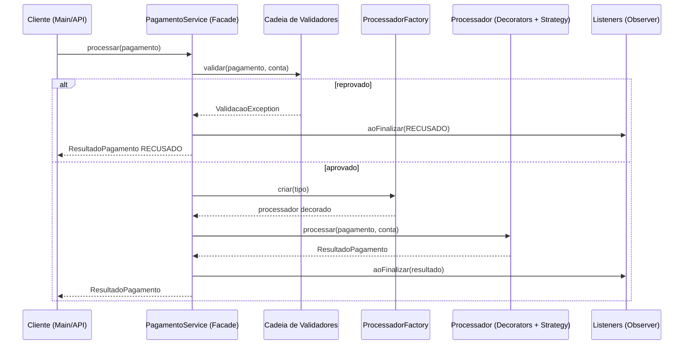
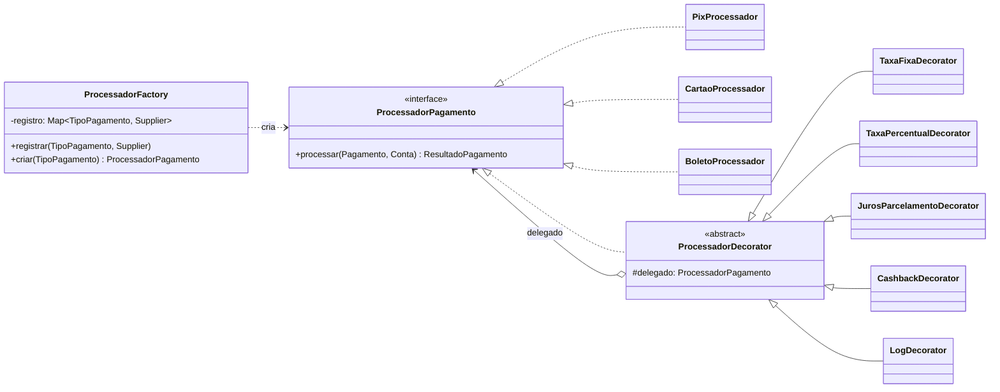

# Simulador de Pagamentos — Design Patterns em Java

[](https://github.com/EduardoModoloDev/java-payment-design-patterns/actions/workflows/ci.yml)


Simulador de processamento de pagamentos (**Pix**, **cartão de crédito** e **boleto**) de uma conta bancária fictícia.
O núcleo é escrito em **Java 21 puro** e aplica **7 padrões de projeto**, cada um resolvendo um problema concreto do
domínio. Por cima dele, uma **API REST com Spring Boot** e Swagger expõe o simulador sem que o núcleo dependa do
framework.

> Projeto final do desafio de **Padrões de Projeto** do curso de Java (Itaú).

## Problema e visão geral

Cada meio de pagamento tem regras próprias: o Pix debita o saldo na hora e tem limite noturno; o cartão debita o limite,
cobra taxa e juros de parcelamento e dá cashback; o boleto cobra uma taxa fixa e só é debitado quando é pago. Antes de
processar, o pagamento passa por validações (dados, horário, saldo, limite diário e antifraude), e ao final e-mail, SMS
e auditoria precisam ser avisados.

O simulador faz tudo isso em memória, sem integrações reais. O foco está em manter o código **aberto para extensão e
fechado para modificação**: um meio de pagamento, uma taxa, uma validação ou uma notificação nova é **uma classe
nova**, sem mexer nas existentes.

## Padrões utilizados

| # | Padrão | Categoria | Onde é usado | Problema que resolve |
|---|---|---|---|---|
| 1 | **Strategy** | Comportamental | [`strategy/`](src/main/java/io/github/eduardomodolodev/pagamentos/strategy) — `ProcessadorPagamento`, `Pix/Cartao/BoletoProcessador` | Cada meio de pagamento tem sua regra, sem `if/else` gigante |
| 2 | **Factory Method** (com registro) | Criacional | [`factory/`](src/main/java/io/github/eduardomodolodev/pagamentos/factory) — `ProcessadorFactory` | Escolhe e monta o processador certo sem espalhar `new` nem `switch` |
| 3 | **Chain of Responsibility** | Comportamental | [`validation/`](src/main/java/io/github/eduardomodolodev/pagamentos/validation) — `Validador` e 5 validadores | Validações independentes, ordenáveis e fáceis de adicionar |
| 4 | **Decorator** | Estrutural | [`decorator/`](src/main/java/io/github/eduardomodolodev/pagamentos/decorator) — taxas, juros, cashback e log | Acrescenta comportamento sem alterar os processadores |
| 5 | **Observer** | Comportamental | [`observer/`](src/main/java/io/github/eduardomodolodev/pagamentos/observer) — `PagamentoListener`, e-mail, SMS e auditoria | Notifica interessados sem acoplá-los ao pagamento |
| 6 | **Builder** | Criacional | [`domain/Pagamento.java`](src/main/java/io/github/eduardomodolodev/pagamentos/domain/Pagamento.java) — `Pagamento.builder()` | Objeto com campos opcionais sem construtor gigante |
| 7 | **Facade** | Estrutural | [`service/`](src/main/java/io/github/eduardomodolodev/pagamentos/service) — `PagamentoService` | Ponto único de entrada que orquestra todos os padrões |

## Diagramas

### Sequência de um pagamento



### Classes de Strategy + Decorator



A factory monta cada tipo assim (de fora para dentro):

| Tipo | Composição |
|---|---|
| Pix | `LogDecorator` → `PixProcessador` |
| Cartão | `LogDecorator` → `CashbackDecorator(1%)` → `TaxaPercentualDecorator(2,5%)` → `JurosParcelamentoDecorator` → `CartaoProcessador` |
| Boleto | `LogDecorator` → `TaxaFixaDecorator(R$ 3,50)` → `BoletoProcessador` |

Os decorators de taxa agem **antes** do núcleo, para que o débito seja de `valor + taxa`; cashback e log olham o
resultado **depois**.

## Regras de negócio

| Meio | Regras |
|---|---|
| **Pix** | Aprovação imediata, sem taxa, debita o saldo. Das 20h às 6h, no máximo R$ 1.000,00 por transação. |
| **Cartão** | Debita o limite do cartão (não o saldo). Taxa de 2,5%. De 1 a 12x: até 3x sem juros; acima disso, 1,5% por parcela além da 3ª. Cashback de 1% sobre o valor. |
| **Boleto** | Taxa fixa de R$ 3,50. Nasce `PENDENTE` (nada é debitado). O vencimento não pode estar no passado. `confirmarBoleto` reconfere o saldo, debita `valor + taxa` e aprova, ou recusa se não houver saldo. |
| **Limite diário** | Pix e boleto aprovados no dia + o valor atual não podem passar do limite da conta (padrão R$ 5.000,00). Cartão fica de fora. |

Exemplo do cartão: R$ 1.200,00 em 6x → taxa R$ 30,00 + juros R$ 54,00 = **R$ 84,00**; total **R$ 1.284,00**
(6 × R$ 214,00); cashback **R$ 12,00**.

### Cadeia de validações

Das mais baratas para as mais caras. A primeira que reprovar interrompe a cadeia, e o pagamento volta como `RECUSADO`
com um código estável:

```
ValidadorDadosBasicos → ValidadorHorario → ValidadorSaldoOuLimite → ValidadorLimiteDiario → ValidadorAntifraude
```

| Validador | Regra | Códigos |
|---|---|---|
| `ValidadorDadosBasicos` | Valor > 0, destinatário preenchido, cartão com 1 a 12 parcelas, boleto com vencimento válido | `DADOS_INVALIDOS`, `PARCELAS_INVALIDAS`, `BOLETO_VENCIDO` |
| `ValidadorHorario` | Pix entre 20h e 6h acima de R$ 1.000,00 | `LIMITE_NOTURNO_EXCEDIDO` |
| `ValidadorSaldoOuLimite` | Pix/boleto: saldo ≥ valor; cartão: limite ≥ valor | `SALDO_INSUFICIENTE`, `LIMITE_CARTAO_INSUFICIENTE` |
| `ValidadorLimiteDiario` | Soma do dia + valor ≤ limite diário (exceto cartão) | `LIMITE_DIARIO_EXCEDIDO` |
| `ValidadorAntifraude` | 5+ pagamentos em 2 minutos; ou valor > 5× a média com 3+ aprovados | `FRAUDE_VELOCIDADE`, `FRAUDE_VALOR_ATIPICO` |

### Notificações

| Listener | Quando dispara |
|---|---|
| `EmailListener` | Todo resultado |
| `SmsListener` | Pagamento recusado ou de valor ≥ R$ 1.000,00 |
| `AuditoriaListener` | Todo resultado, em memória e, opcionalmente, em arquivo (`auditoria.log`) |

Um listener que falhar é registrado em log e ignorado: não derruba o pagamento nem impede os demais de serem avisados.

## Como executar

Pré-requisito: JDK 21 ou superior. O Maven Wrapper já está incluído, não é preciso instalar o Maven.

```bash
# compila e roda os testes
./mvnw clean test

# demonstração em Java puro (Main): roda os 10 cenários no console
./mvnw -q compile exec:java

# API REST (Spring Boot) em http://localhost:8080
./mvnw spring-boot:run

# ou gera o jar da API e executa
./mvnw -q package -DskipTests
java -jar target/java-payment-design-patterns-1.1.0.jar
```

No Windows, use `mvnw.cmd` no lugar de `./mvnw`.

A demonstração usa um relógio simulado e roda os 10 cenários da especificação:

| # | Cenário | Resultado |
|---|---|---|
| 1 | Pix de R$ 200,00 com saldo suficiente | `APROVADO`, taxa 0 |
| 2 | Pix de R$ 1.500,00 às 22h | `RECUSADO` — `LIMITE_NOTURNO_EXCEDIDO` |
| 3 | Cartão de R$ 1.200,00 em 6x | `APROVADO`, taxa R$ 84,00, total R$ 1.284,00, cashback R$ 12,00 |
| 4 | Cartão de R$ 900,00 em 13x | `RECUSADO` — `PARCELAS_INVALIDAS` |
| 5 | Boleto de R$ 350,00 com vencimento futuro | `PENDENTE`, taxa R$ 3,50 |
| 6 | `confirmarBoleto` do cenário 5 | `APROVADO`, débito de R$ 353,50 |
| 7 | Boleto vencido | `RECUSADO` — `BOLETO_VENCIDO` |
| 8 | Pix maior que o saldo | `RECUSADO` — `SALDO_INSUFICIENTE` |
| 9 | 5 pagamentos seguidos em poucos segundos | o 6º é `RECUSADO` — `FRAUDE_VELOCIDADE` |
| 10 | Pagamentos acumulados passando de R$ 5.000,00 no dia | `RECUSADO` — `LIMITE_DIARIO_EXCEDIDO` |

Os mesmos 10 cenários também são verificados automaticamente em
[`CenariosEspecificacaoTest`](src/test/java/io/github/eduardomodolodev/pagamentos/service/CenariosEspecificacaoTest.java).

## API REST

Com a API no ar, a documentação interativa fica em **http://localhost:8080/swagger-ui.html** (o contrato OpenAPI em
`/v3/api-docs`). A aplicação já sobe com as contas de demonstração `CONTA-001`, `CONTA-002` e `CONTA-003`.

| Método | Rota | Descrição |
|---|---|---|
| `POST` | `/api/pagamentos` | Cria e processa um pagamento |
| `GET` | `/api/pagamentos/{id}` | Consulta um pagamento |
| `POST` | `/api/pagamentos/{id}/confirmar` | Confirma um boleto pendente |
| `GET` | `/api/contas/{id}` | Consulta saldo, limites e dados da conta |
| `GET` | `/api/contas/{id}/pagamentos` | Histórico de pagamentos da conta |

**Convenções HTTP**

| Status | Quando |
|---|---|
| `201 Created` | Pagamento processado, **inclusive recusado por regra de negócio**: `status` e `codigo` no corpo dizem o que houve |
| `200 OK` | Consultas e confirmação de boleto |
| `400 Bad Request` | JSON inválido ou campos obrigatórios ausentes |
| `404 Not Found` | Conta ou pagamento inexistente |
| `409 Conflict` | Confirmar um pagamento que não é um boleto pendente |

Os erros seguem o formato padrão [Problem Details](https://www.rfc-editor.org/rfc/rfc9457) (`application/problem+json`).

### Exemplos com curl

Cartão de R$ 1.200,00 em 6x:

```bash
curl -i -X POST http://localhost:8080/api/pagamentos \
  -H "Content-Type: application/json" \
  -d '{"contaOrigemId":"CONTA-001","tipo":"CARTAO_CREDITO","valor":1200.00,"destinatario":"Loja do Zé","parcelas":6}'
```

```http
HTTP/1.1 201 Created
Location: http://localhost:8080/api/pagamentos/b7d9c1e2-5a34-4c8e-9f21-3a6d8e0f1b22

{
  "pagamentoId": "b7d9c1e2-5a34-4c8e-9f21-3a6d8e0f1b22",
  "status": "APROVADO",
  "codigo": null,
  "mensagem": "Pagamento no cartão aprovado em 6x",
  "valor": 1200.00,
  "taxa": 84.00,
  "total": 1284.00,
  "cashback": 12.00,
  "processadoEm": "2026-11-17T14:00:00"
}
```

Recusa de negócio (13 parcelas) também responde `201`, com o motivo no corpo:

```bash
curl -X POST http://localhost:8080/api/pagamentos \
  -H "Content-Type: application/json" \
  -d '{"contaOrigemId":"CONTA-001","tipo":"CARTAO_CREDITO","valor":900.00,"destinatario":"Loja do Zé","parcelas":13}'
# {"status":"RECUSADO","codigo":"PARCELAS_INVALIDAS", ...}
```

Boleto e confirmação:

```bash
curl -X POST http://localhost:8080/api/pagamentos \
  -H "Content-Type: application/json" \
  -d '{"contaOrigemId":"CONTA-001","tipo":"BOLETO","valor":350.00,"destinatario":"Companhia de Energia","dataVencimento":"2026-12-10"}'
# {"pagamentoId":"<id>","status":"PENDENTE","taxa":3.50,"total":353.50, ...}

curl -X POST http://localhost:8080/api/pagamentos/<id>/confirmar
# {"status":"APROVADO","mensagem":"Boleto pago","total":353.50, ...}
```

Conta e histórico:

```bash
curl http://localhost:8080/api/contas/CONTA-001
# {"id":"CONTA-001","titular":"Maria Silva","saldo":2646.50,"limiteCartaoDisponivel":3716.00,"limiteDiario":5000.00}

curl http://localhost:8080/api/contas/CONTA-001/pagamentos
```

Erro de requisição (campos ausentes):

```bash
curl -X POST http://localhost:8080/api/pagamentos -H "Content-Type: application/json" -d '{}'
# 400 {"title":"Requisição inválida","campos":{"contaOrigemId":"é obrigatório","tipo":"é obrigatório", ...}}
```

## Como adicionar um novo meio de pagamento

Exemplo: "Débito". Nenhum `if/else` ou `switch` existente precisa ser alterado.

1. Adicionar `DEBITO` ao enum `TipoPagamento`.
2. Criar `DebitoProcessador implements ProcessadorPagamento`.
3. Registrar na factory:
   ```java
   factory.registrar(TipoPagamento.DEBITO, () -> new LogDecorator(new DebitoProcessador()));
   ```
4. Se houver regra específica, criar um novo `Validador` e encaixá-lo na cadeia.

O mesmo vale para o resto: uma taxa nova é um `ProcessadorDecorator`, uma notificação nova é um `PagamentoListener`.

## Decisões de projeto

- **Dinheiro em `BigDecimal`**, sempre com escala 2 e `HALF_UP`. Nunca `double`/`float`. Os testes comparam valores
  exatos (`new BigDecimal("1284.00")`).
- **`Clock` injetado** no service, nos validadores e nos processadores: as regras de horário e de janelas de tempo são
  testadas sem depender do relógio real.
- **Recusa não é exceção para quem chama:** o `PagamentoService` captura a `ValidacaoException` e devolve um
  `ResultadoPagamento` `RECUSADO` com o código do erro. Exceção fica só para erro de uso (conta ou pagamento
  inexistente).
- **Defesa em profundidade:** as validações checam só o `valor`, porque as taxas só são conhecidas depois, nos
  decorators. Por isso cada processador faz uma verificação final de `valor + taxa` antes de debitar, e pode recusar com
  `SALDO_INSUFICIENTE` / `LIMITE_CARTAO_INSUFICIENTE`.
- **Repositórios atrás de interfaces:** as implementações em memória podem ser trocadas por JPA sem tocar na regra de
  negócio.
- **Regra de ouro da arquitetura:** o Spring só aparece em `api/` e `config/`. O núcleo não tem nenhuma anotação de
  framework; a `NucleoConfig` monta os mesmos objetos que o `Main` monta à mão. O
  [`ArquiteturaTest`](src/test/java/io/github/eduardomodolodev/pagamentos/ArquiteturaTest.java) quebra o build se algum
  pacote do núcleo importar Spring, Jakarta ou Swagger.
- **Bean Validation só para estrutura:** campos ausentes viram `400`; regras de negócio (valor positivo, parcelas,
  vencimento) continuam na cadeia de validadores e viram pagamento `RECUSADO`, igual no Java puro.
- **Padrões deliberadamente não usados:** Singleton (dificulta testes; a injeção manual de dependências no `Main`
  resolve) e Template Method (não há um algoritmo com esqueleto fixo que justifique). Saber quando **não** usar um padrão
  também é parte do projeto.

## Estrutura

```
src/main/java/io/github/eduardomodolodev/pagamentos/
├── Main.java        → demonstração em Java puro (10 cenários)
├── domain/          → Conta, Pagamento (+Builder), ResultadoPagamento, enums, códigos de recusa
├── repository/      → interfaces + implementações em memória
├── strategy/        → ProcessadorPagamento e Pix/Cartao/BoletoProcessador
├── decorator/       → ProcessadorDecorator, TaxaFixa, TaxaPercentual, JurosParcelamento, Cashback, Log
├── factory/         → ProcessadorFactory (registro por tipo, já com decorators)
├── validation/      → Validador (base), 5 validadores, CadeiaValidadores, ValidacaoException
├── observer/        → PagamentoListener, Email/Sms/AuditoriaListener
├── service/         → PagamentoService (Facade)
├── api/             → controllers, DTOs e tratamento global de erros (Spring)
└── config/          → SimuladorApiApplication, NucleoConfig e OpenApiConfig (Spring)
src/test/java/...    → testes espelhando os pacotes acima, incluindo MockMvc e o teste de arquitetura
.github/workflows/   → CI no GitHub Actions (build e testes com Java 21)
```

## Roadmap

- [x] Fase 1 — Núcleo em Java puro (Strategy + Factory + Builder) — `v0.1.0`
- [x] Fase 2 — Validações e Decorators (Chain of Responsibility + Decorator) — `v0.2.0`
- [x] Fase 3 — Observer, confirmação de boleto e testes de ponta a ponta — `v1.0.0`
- [x] Fase 4 — API REST com Spring Boot, Swagger e CI — `v1.1.0`

Evoluções futuras:

- Persistência real com Spring Data JPA + H2/PostgreSQL (trocando só os repositórios).
- Estorno de pagamentos com o padrão **Command** (`desfazer()`).
- Ciclo de vida do pagamento como máquina de estados (padrão **State**).
- Notificações assíncronas (eventos/filas).
- Autenticação com JWT.
- Dockerfile para subir a API em contêiner.
- Migração para o Spring Boot 4 (a especificação pede a linha 3.x).

A especificação completa está em [docs/ESPECIFICACAO.md](docs/ESPECIFICACAO.md).

## Autor

Eduardo Modolo — [GitHub](https://github.com/EduardoModoloDev)
