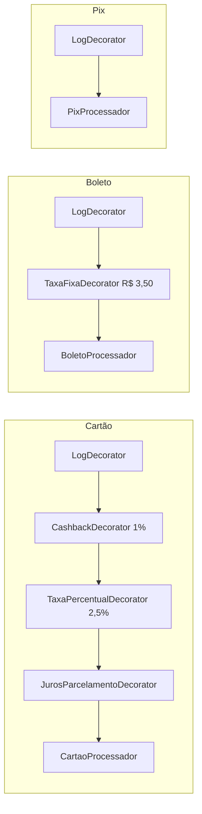

# Simulador de Pagamentos — Design Patterns em Java


Simulador de processamento de pagamentos (**Pix**, **cartão de crédito** e **boleto**) de uma conta bancária fictícia,
escrito em Java 21 puro. O foco é a **arquitetura**: cada padrão de projeto existe porque resolve um problema concreto
do domínio.

> Projeto final do desafio de **Padrões de Projeto** do curso de Java (Itaú).

## Padrões de projeto

| Padrão | Categoria | Onde é usado | Status |
|---|---|---|---|
| Strategy | Comportamental | [`ProcessadorPagamento`](src/main/java/io/github/eduardomodolodev/pagamentos/strategy) e suas implementações | ✅ |
| Factory Method (com registro) | Criacional | [`ProcessadorFactory`](src/main/java/io/github/eduardomodolodev/pagamentos/factory) | ✅ |
| Chain of Responsibility | Comportamental | [Cadeia de `Validador`](src/main/java/io/github/eduardomodolodev/pagamentos/validation) | ✅ |
| Decorator | Estrutural | [`TaxaFixa`, `TaxaPercentual`, `JurosParcelamento`, `Cashback`, `Log`](src/main/java/io/github/eduardomodolodev/pagamentos/decorator) | ✅ |
| Builder | Criacional | [`Pagamento.Builder`](src/main/java/io/github/eduardomodolodev/pagamentos/domain/Pagamento.java) | ✅ |
| Facade | Estrutural | [`PagamentoService`](src/main/java/io/github/eduardomodolodev/pagamentos/service) | ✅ |
| Observer | Comportamental | `PagamentoListener` e implementações | Fase 3 |

## Regras de negócio

| Meio | Regras |
|---|---|
| **Pix** | Aprovação imediata, sem taxa, debita o saldo. Das 20h às 6h, no máximo R$ 1.000,00 por transação. |
| **Cartão** | Debita o limite do cartão. Taxa de 2,5%. Até 3x sem juros; acima disso, 1,5% por parcela além da 3ª. Cashback de 1%. |
| **Boleto** | Taxa fixa de R$ 3,50. Fica `PENDENTE` (nada é debitado na criação). O vencimento não pode estar no passado. |
| **Limite diário** | Pix e boleto aprovados no dia + o valor atual não podem passar de R$ 5.000,00 (cartão fica de fora). |

Exemplo do cartão: R$ 1.200,00 em 6x → taxa R$ 30,00 + juros R$ 54,00 = **R$ 84,00**; total **R$ 1.284,00**
(6 × R$ 214,00); cashback **R$ 12,00**.

### Cadeia de validações

Das mais baratas para as mais caras. A primeira que reprovar interrompe a cadeia, e o pagamento volta como `RECUSADO`
com um código estável:

```
ValidadorDadosBasicos → ValidadorHorario → ValidadorSaldoOuLimite → ValidadorLimiteDiario → ValidadorAntifraude
```

| Validador | Códigos |
|---|---|
| `ValidadorDadosBasicos` | `DADOS_INVALIDOS`, `PARCELAS_INVALIDAS`, `BOLETO_VENCIDO` |
| `ValidadorHorario` | `LIMITE_NOTURNO_EXCEDIDO` |
| `ValidadorSaldoOuLimite` | `SALDO_INSUFICIENTE`, `LIMITE_CARTAO_INSUFICIENTE` |
| `ValidadorLimiteDiario` | `LIMITE_DIARIO_EXCEDIDO` |
| `ValidadorAntifraude` | `FRAUDE_VELOCIDADE` (5+ pagamentos em 2 min), `FRAUDE_VALOR_ATIPICO` (> 5× a média) |

### Composição dos processadores (Decorator + Strategy)



Os decorators de taxa agem **antes** do núcleo, para que o débito seja de `valor + taxa`; cashback e log olham o
resultado **depois**.

## Como executar

Pré-requisito: JDK 21 ou superior. O Maven Wrapper já está incluído, não é preciso instalar o Maven.

```bash
# compila e roda os testes
./mvnw clean test

# executa a demonstração (Main)
./mvnw -q compile exec:java
```

No Windows, use `mvnw.cmd` no lugar de `./mvnw`.

A demonstração usa um relógio simulado e roda os cenários da especificação:

| # | Cenário | Resultado |
|---|---|---|
| 1 | Pix de R$ 200,00 com saldo suficiente | `APROVADO`, taxa 0 |
| 2 | Pix de R$ 1.500,00 às 22h | `RECUSADO` — `LIMITE_NOTURNO_EXCEDIDO` |
| 3 | Cartão de R$ 1.200,00 em 6x | `APROVADO`, taxa R$ 84,00, total R$ 1.284,00, cashback R$ 12,00 |
| 4 | Cartão de R$ 900,00 em 13x | `RECUSADO` — `PARCELAS_INVALIDAS` |
| 5 | Boleto de R$ 350,00 com vencimento futuro | `PENDENTE`, taxa R$ 3,50 |
| 7 | Boleto vencido | `RECUSADO` — `BOLETO_VENCIDO` |
| 8 | Pix maior que o saldo | `RECUSADO` — `SALDO_INSUFICIENTE` |
| 9 | 5 pagamentos seguidos em poucos segundos | o 6º é `RECUSADO` — `FRAUDE_VELOCIDADE` |
| 10 | Pagamentos acumulados passando de R$ 5.000,00 no dia | `RECUSADO` — `LIMITE_DIARIO_EXCEDIDO` |

O cenário 6 (`confirmarBoleto`) chega na Fase 3.

## Decisões de projeto

- **Dinheiro em `BigDecimal`**, sempre com escala 2 e `HALF_UP`. Nunca `double`/`float`.
- **`Clock` injetado** nos validadores, processadores e no service: as regras de horário são testadas sem depender do
  relógio real.
- **Recusa não é exceção para quem chama:** o `PagamentoService` captura a `ValidacaoException` e devolve um
  `ResultadoPagamento` `RECUSADO` com o código do erro.
- **Defesa em profundidade:** as validações checam só o `valor`, porque as taxas só são conhecidas depois, nos
  decorators. Por isso cada processador faz uma verificação final de `valor + taxa` antes de debitar.
- **Padrões não usados de propósito:** Singleton (dificulta testes; a injeção manual de dependências resolve) e Template
  Method (não há um algoritmo com esqueleto fixo que justifique).

## Estrutura

```
src/main/java/io/github/eduardomodolodev/pagamentos/
├── Main.java        → demonstração em Java puro
├── domain/          → Conta, Pagamento (+Builder), ResultadoPagamento, enums, códigos de recusa
├── repository/      → interfaces + implementações em memória
├── strategy/        → ProcessadorPagamento e Pix/Cartao/BoletoProcessador
├── decorator/       → ProcessadorDecorator, TaxaFixa, TaxaPercentual, JurosParcelamento, Cashback, Log
├── factory/         → ProcessadorFactory (registro por tipo, já com decorators)
├── validation/      → Validador (base), 5 validadores, CadeiaValidadores, ValidacaoException
└── service/         → PagamentoService (Facade)
```

## Roadmap

- [x] Fase 1 — Núcleo em Java puro (Strategy + Factory + Builder) — `v0.1.0`
- [x] Fase 2 — Validações e Decorators (Chain of Responsibility + Decorator) — `v0.2.0`
- [ ] Fase 3 — Observer, confirmação de boleto e testes
- [ ] Fase 4 — API REST com Spring Boot (opcional)

A especificação completa está em [docs/ESPECIFICACAO.md](docs/ESPECIFICACAO.md).

## Autor

Eduardo Modolo — [GitHub](https://github.com/EduardoModoloDev)
