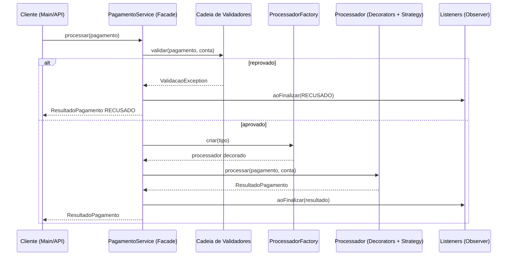

# Simulador de Pagamentos — Design Patterns em Java

> Especificação completa do projeto final do curso de Java (Itaú) — desafio de **Padrões de Projeto (Design Patterns)**.

## 1. Visão geral

Uma aplicação que **simula o processamento de pagamentos** (Pix, cartão de crédito e boleto) de uma conta bancária
fictícia. Nenhuma integração real é feita: o foco é a **arquitetura** — cada padrão de projeto existe porque resolve um
problema concreto do domínio, e não só para "aparecer" no código.

**Objetivos:**

1. Cumprir o desafio do curso (aplicar padrões de projeto em Java, de forma prática).
2. Gerar um repositório de portfólio com cara de projeto backend real: domínio bem modelado, regras de negócio,
   testes e documentação.
3. Ser extensível: adicionar um novo meio de pagamento ou uma nova validação deve exigir **criar uma classe nova**,
   e não alterar as existentes (princípio Aberto/Fechado).

**Abordagem escolhida no desafio:** "Criar do Zero" — ideia nova aplicando os padrões vistos, primeiro em **Java puro**
(fases 1 a 3) e depois, opcionalmente, com **Spring Boot** expondo uma API REST (fase 4).

## 2. Padrões de projeto utilizados

| # | Padrão | Categoria | Onde é usado | Problema que resolve |
|---|---|---|---|---|
| 1 | **Strategy** | Comportamental | `ProcessadorPagamento` e suas implementações | Cada meio de pagamento tem regra própria, sem `if/else` gigante |
| 2 | **Factory Method** (com registro) | Criacional | `ProcessadorFactory` | Escolher e montar o processador correto sem espalhar `new` |
| 3 | **Chain of Responsibility** | Comportamental | Cadeia de `Validador` | Validações independentes, ordenáveis e fáceis de adicionar |
| 4 | **Decorator** | Estrutural | `TaxaDecorator`, `CashbackDecorator`, `LogDecorator` | Acrescentar taxas, cashback e log sem alterar os processadores |
| 5 | **Observer** | Comportamental | `PagamentoListener` e implementações | Notificar e-mail/SMS/auditoria sem acoplar ao pagamento |
| 6 | **Builder** | Criacional | `Pagamento.Builder` | Objeto com campos opcionais (parcelas, vencimento) sem construtor gigante |
| 7 | **Facade** | Estrutural | `PagamentoService` | Ponto único de entrada que orquestra todos os padrões |

**Padrões deliberadamente não usados:** Singleton (dificulta testes; a injeção manual de dependências resolve) e
Template Method (não há algoritmo com esqueleto fixo que justifique). No README, vale registrar essa decisão: saber
**quando não usar** um padrão também é maturidade.

## 3. Escopo

**Dentro do escopo**

- Cadastro em memória de contas e processamento de pagamentos (Pix, cartão, boleto).
- Validações em cadeia, cálculo de taxas, cashback, parcelamento.
- Notificações simuladas (log no console / arquivo).
- Histórico de pagamentos por conta.
- Testes unitários dos padrões e das regras.
- (Fase 4) API REST com Spring Boot e documentação Swagger.

**Fora do escopo**

- Banco de dados real (usa repositórios em memória; JPA pode ser uma evolução futura).
- Autenticação/autorização.
- Integração real com bancos, adquirentes ou provedores de e-mail/SMS.
- Interface gráfica.

## 4. Stack e convenções técnicas

| Item | Escolha |
|---|---|
| Linguagem | Java 21 (LTS) — usa `record`, `switch` expressions, `sealed` quando fizer sentido |
| Build | Maven |
| Testes | JUnit 5 + AssertJ (opcional) |
| Dinheiro | **Sempre `BigDecimal`** (nunca `double`/`float`), escala 2, `RoundingMode.HALF_UP` |
| Tempo | `java.time` + **`Clock` injetado** (para testar regras de horário sem depender do relógio real) |
| Logs | `System.Logger` ou SLF4J simples; na fase 1 `System.out` é aceitável |
| Fase 4 | Spring Boot 3.x, springdoc-openapi (Swagger) |

**Regra de ouro de arquitetura:** os pacotes de domínio e de padrões **não podem importar nada do Spring**. O Spring
só aparece na camada `api`/`config`. Assim, o núcleo continua Java puro e testável.

**Idioma do código:** nomes de domínio em português (`Pagamento`, `Conta`, `ValidadorSaldo`), nomes técnicos de padrão
como sufixo/comentário (`ProcessadorFactory`, `PagamentoListener`). Pacotes sem acentos.

## 5. Modelo de domínio

### 5.1 Enums

```java
public enum TipoPagamento { PIX, CARTAO_CREDITO, BOLETO }

public enum StatusPagamento { CRIADO, PENDENTE, APROVADO, RECUSADO }
```

### 5.2 Entidades

**Conta** — representa a conta do pagador:

| Campo | Tipo | Observação |
|---|---|---|
| `id` | `String` | Identificador (ex.: `"CONTA-001"`) |
| `titular` | `String` | Nome do titular |
| `saldo` | `BigDecimal` | Usado por Pix e boleto |
| `limiteCartaoDisponivel` | `BigDecimal` | Usado por cartão de crédito |
| `limiteDiario` | `BigDecimal` | Soma máxima de pagamentos **aprovados** no dia (padrão: R$ 5.000,00) |

Métodos: `debitarSaldo(BigDecimal)`, `debitarLimiteCartao(BigDecimal)`, ambos lançando exceção se insuficiente (defesa
final; as validações normalmente barram antes).

**Pagamento** — criado via **Builder**:

| Campo | Tipo | Obrigatório | Observação |
|---|---|---|---|
| `id` | `String` (UUID) | gerado | |
| `contaOrigemId` | `String` | sim | |
| `tipo` | `TipoPagamento` | sim | |
| `valor` | `BigDecimal` | sim | > 0 |
| `destinatario` | `String` | sim | Chave Pix / nome do favorecido / beneficiário do boleto |
| `parcelas` | `int` | só cartão | 1 a 12; padrão 1 |
| `dataVencimento` | `LocalDate` | só boleto | ≥ data atual |
| `criadoEm` | `LocalDateTime` | gerado | Via `Clock` |
| `taxa` | `BigDecimal` | calculado | Começa em 0; decorators acrescentam |
| `cashback` | `BigDecimal` | calculado | Começa em 0 |
| `status` | `StatusPagamento` | gerenciado | Começa em `CRIADO` |

Métodos de apoio: `adicionarTaxa(BigDecimal)`, `adicionarCashback(BigDecimal)`, `getValorTotal()` (= `valor + taxa`).

**ResultadoPagamento** — `record` imutável devolvido ao final:

```java
public record ResultadoPagamento(
        String pagamentoId,
        StatusPagamento status,
        String codigo,          // null se aprovado/pendente; código do erro se recusado
        String mensagem,
        BigDecimal valor,
        BigDecimal taxa,
        BigDecimal total,
        BigDecimal cashback,
        LocalDateTime processadoEm) { }
```

### 5.3 Repositórios (em memória)

- `ContaRepository` (`buscarPorId`, `salvar`) → `ContaRepositoryEmMemoria`
- `PagamentoRepository` (`salvar`, `buscarPorId`, `listarPorConta`) → `PagamentoRepositoryEmMemoria`

São **interfaces**: na fase 4 (ou numa evolução futura) podem ser trocadas por JPA sem tocar na regra de negócio.

## 6. Regras de negócio por meio de pagamento

### 6.1 Pix

- Aprovação **imediata** (`APROVADO`).
- **Sem taxa.**
- Debita o `saldo` da conta pelo valor.
- Restrição noturna (20h às 6h): valor máximo de **R$ 1.000,00** por transação.

### 6.2 Cartão de crédito

- Aprovação imediata (`APROVADO`), debitando o **limite do cartão** (não o saldo).
- **Taxa de processamento: 2,5%** sobre o valor.
- **Parcelamento de 1 a 12x:** até 3x sem juros; de 4x a 12x, juros simples de **1,5% por parcela acima da 3ª** (ou
  seja, `(parcelas − 3) × 1,5%` sobre o valor).
- **Cashback: 1%** sobre o valor (sem taxa/juros), apenas informativo no resultado.

*Exemplo:* compra de R$ 1.200,00 em 6x → taxa 2,5% = R$ 30,00; juros (6 − 3) × 1,5% = 4,5% = R$ 54,00; total =
**R$ 1.284,00**; parcela = **R$ 214,00**; cashback = **R$ 12,00**.

### 6.3 Boleto

- **Taxa fixa de R$ 3,50.**
- Status inicial **`PENDENTE`**: nada é debitado na criação.
- `dataVencimento` obrigatória e não pode estar no passado (recusa com `BOLETO_VENCIDO`).
- Existe a operação `confirmarBoleto(pagamentoId)`, que simula o pagamento do boleto: reconfere o saldo
  (`valor + taxa`), debita e muda para `APROVADO`; se não houver saldo, muda para `RECUSADO`. Em ambos os casos os
  listeners são notificados.

### 6.4 Limite diário (todos os tipos, exceto cartão)

Soma dos pagamentos `APROVADO` do dia (Pix e boleto confirmado) + o valor atual não pode exceder `limiteDiario` da
conta.

## 7. Cadeia de validações (Chain of Responsibility)

**Ordem da cadeia — validações baratas primeiro, mais caras por último:**

```
ValidadorDadosBasicos → ValidadorHorario → ValidadorSaldoOuLimite → ValidadorLimiteDiario → ValidadorAntifraude
```

| Validador | Regra | Código do erro |
|---|---|---|
| `ValidadorDadosBasicos` | Valor > 0; destinatário não vazio; tipo informado; cartão com parcelas entre 1 e 12; boleto com vencimento válido | `DADOS_INVALIDOS`, `PARCELAS_INVALIDAS`, `BOLETO_VENCIDO` |
| `ValidadorHorario` | Pix entre 20h e 6h acima de R$ 1.000,00 | `LIMITE_NOTURNO_EXCEDIDO` |
| `ValidadorSaldoOuLimite` | Pix/boleto: `saldo ≥ valor`; cartão: `limiteCartaoDisponivel ≥ valor` | `SALDO_INSUFICIENTE`, `LIMITE_CARTAO_INSUFICIENTE` |
| `ValidadorLimiteDiario` | Ver 6.4 (não se aplica a cartão) | `LIMITE_DIARIO_EXCEDIDO` |
| `ValidadorAntifraude` | (a) 5 ou mais pagamentos da conta nos últimos 2 minutos; (b) conta com ≥ 3 aprovados e valor > 5× a média dos aprovados | `FRAUDE_VELOCIDADE`, `FRAUDE_VALOR_ATIPICO` |

**Observação de projeto:** as validações checam contra o `valor` (as taxas só são conhecidas depois, nos decorators).
Por isso o processador faz uma **verificação final** de `valor + taxa` e pode recusar com `SALDO_INSUFICIENTE`.
Documente isso no README como "defesa em profundidade".

**Esqueleto do validador base (a cadeia):**

```java
public abstract class Validador {
    private Validador proximo;

    public Validador proximo(Validador proximo) {
        this.proximo = proximo;
        return proximo; // permite encadear fluentemente
    }

    public final void validar(Pagamento pagamento, Conta conta) {
        verificar(pagamento, conta);          // lança ValidacaoException se reprovar
        if (proximo != null) {
            proximo.validar(pagamento, conta);
        }
    }

    protected abstract void verificar(Pagamento pagamento, Conta conta);
}
```

**Exceção de validação, com código estável para o resultado:**

```java
public class ValidacaoException extends RuntimeException {
    private final String codigo;

    public ValidacaoException(String codigo, String mensagem) {
        super(mensagem);
        this.codigo = codigo;
    }

    public String getCodigo() { return codigo; }
}
```

Importante: o `PagamentoService` **captura** `ValidacaoException` e a converte em `ResultadoPagamento` com status
`RECUSADO` (e notifica os listeners). Recusa de negócio não é erro de sistema — não deve vazar como exceção para quem
chama.

## 8. Strategy, Factory e Decorator — como se encaixam

### 8.1 Strategy — o núcleo de cada pagamento

**Interface comum:**

```java
public interface ProcessadorPagamento {
    ResultadoPagamento processar(Pagamento pagamento, Conta conta);
}
```

Implementações **"núcleo"** (só fazem a operação em si, sem taxa/log):

- `PixProcessador`: confere `saldo ≥ valorTotal`, debita saldo, status `APROVADO`.
- `CartaoProcessador`: confere `limite ≥ valorTotal`, debita limite, status `APROVADO`.
- `BoletoProcessador`: não debita; status `PENDENTE`.

### 8.2 Decorator — o que "embrulha" o núcleo

**Base abstrata dos decorators:**

```java
public abstract class ProcessadorDecorator implements ProcessadorPagamento {
    protected final ProcessadorPagamento delegado;

    protected ProcessadorDecorator(ProcessadorPagamento delegado) {
        this.delegado = delegado;
    }
}
```

| Decorator | Faz o quê | Usado em |
|---|---|---|
| `TaxaPercentualDecorator(percentual)` | Soma `valor × percentual` à taxa **antes** de delegar | Cartão (2,5%) |
| `JurosParcelamentoDecorator` | Soma `(parcelas − 3) × 1,5% × valor` se parcelas > 3 | Cartão |
| `TaxaFixaDecorator(valor)` | Soma taxa fixa antes de delegar | Boleto (R$ 3,50) |
| `CashbackDecorator(percentual)` | Após o sucesso, calcula cashback sobre o valor | Cartão (1%) |
| `LogDecorator` | Registra entrada e saída (tempo, tipo, valor, status) | Todos |

A ordem importa: decorators de taxa precisam rodar **antes** do núcleo (para que o débito use `valor + taxa`); cashback
e log olham o resultado **depois**.

### 8.3 Factory — monta tudo por tipo

**Fábrica com registro (mapa de `Supplier`), que evita um `switch` a ser editado a cada novo tipo:**

```java
public class ProcessadorFactory {
    private final Map<TipoPagamento, Supplier<ProcessadorPagamento>> registro =
            new EnumMap<>(TipoPagamento.class);

    public ProcessadorFactory() {
        registrar(TipoPagamento.PIX,
                () -> new LogDecorator(new PixProcessador()));

        registrar(TipoPagamento.CARTAO_CREDITO,
                () -> new LogDecorator(
                        new CashbackDecorator(new BigDecimal("0.01"),
                        new TaxaPercentualDecorator(new BigDecimal("0.025"),
                        new JurosParcelamentoDecorator(
                        new CartaoProcessador())))));

        registrar(TipoPagamento.BOLETO,
                () -> new LogDecorator(
                        new TaxaFixaDecorator(new BigDecimal("3.50"),
                        new BoletoProcessador())));
    }

    public void registrar(TipoPagamento tipo, Supplier<ProcessadorPagamento> montagem) {
        registro.put(tipo, montagem);
    }

    public ProcessadorPagamento criar(TipoPagamento tipo) {
        Supplier<ProcessadorPagamento> montagem = registro.get(tipo);
        if (montagem == null) {
            throw new IllegalArgumentException("Tipo de pagamento não suportado: " + tipo);
        }
        return montagem.get();
    }
}
```

> Ajuste os construtores dos decorators para receber o delegado como último argumento, conforme o exemplo.

## 9. Observer — notificações

**Interface do ouvinte (use a sua própria; `java.util.Observer` está obsoleta):**

```java
public interface PagamentoListener {
    void aoFinalizar(Pagamento pagamento, ResultadoPagamento resultado);
}
```

| Listener | Comportamento |
|---|---|
| `EmailListener` | Simula envio de e-mail para **todo** resultado (apenas imprime/loga `[EMAIL] ...`) |
| `SmsListener` | Dispara apenas se o pagamento foi **recusado** ou se o valor for ≥ R$ 1.000,00 |
| `AuditoriaListener` | Guarda **todo** evento (lista em memória e, opcionalmente, linhas em `auditoria.log`) |

O `PagamentoService` mantém uma `List<PagamentoListener>`, expõe `registrarListener(...)` e notifica todos ao final de
cada pagamento (e de cada `confirmarBoleto`). Um listener que falhar **não pode** derrubar o fluxo nem impedir os
demais (capturar exceção por listener).

## 10. Builder — criação de `Pagamento`

**Uso esperado, com campos opcionais só quando fazem sentido:**

```java
Pagamento pagamento = Pagamento.builder()
        .contaOrigemId("CONTA-001")
        .tipo(TipoPagamento.CARTAO_CREDITO)
        .valor(new BigDecimal("1200.00"))
        .destinatario("Loja do Zé")
        .parcelas(6)
        .build();
```

O `build()` aplica o que pode ser garantido na construção (ex.: campos obrigatórios não nulos, `parcelas` padrão 1,
`id` e `criadoEm` gerados); regras de negócio mais ricas ficam nos validadores.

## 11. Facade — `PagamentoService`

**Fluxo orquestrado por `processar(Pagamento)`:**

1. Busca a conta (erro claro se não existir).
2. Salva o pagamento com status `CRIADO`.
3. Executa a cadeia de validações. Se lançar `ValidacaoException` → monta resultado `RECUSADO`, salva, notifica,
   retorna.
4. Pede o processador à `ProcessadorFactory` (já decorado).
5. Executa `processar(...)`, atualiza status/taxa/cashback do pagamento e persiste conta e pagamento.
6. Notifica os listeners e devolve o `ResultadoPagamento`.

Também expõe: `confirmarBoleto(String pagamentoId)`, `buscarPagamento(String id)`, `listarPagamentos(String contaId)`.

**Diagrama de sequência:**



## 12. Estrutura do projeto

```
java-payment-design-patterns/
├── pom.xml
├── README.md
├── docs/
│   └── ESPECIFICACAO.md            ← este documento
├── src/
│   ├── main/java/io/github/eduardomodolodev/pagamentos/
│   │   ├── Main.java               → demonstração em Java puro (fases 1-3)
│   │   ├── domain/                 → Conta, Pagamento (+Builder), ResultadoPagamento, enums
│   │   ├── repository/             → interfaces + implementações em memória
│   │   ├── strategy/               → ProcessadorPagamento, Pix/Cartao/BoletoProcessador
│   │   ├── decorator/              → ProcessadorDecorator, Taxa*, Juros*, Cashback*, Log*
│   │   ├── factory/                → ProcessadorFactory
│   │   ├── validation/             → Validador (base), 5 validadores, ValidacaoException
│   │   ├── observer/               → PagamentoListener, Email/Sms/AuditoriaListener
│   │   └── service/                → PagamentoService (Facade)
│   └── test/java/io/github/eduardomodolodev/pagamentos/ → testes espelhando os pacotes acima
└── (fase 4) api/ e config/         → controllers, DTOs, @Configuration (Spring)
```

## 13. Dados de demonstração (`Main`)

O `Main` deve criar 2 ou 3 contas e rodar cenários que **provem cada regra**, imprimindo os resultados:

| # | Cenário | Resultado esperado |
|---|---|---|
| 1 | Pix de R$ 200,00 com saldo suficiente | `APROVADO`, taxa 0 |
| 2 | Pix de R$ 1.500,00 às 22h | `RECUSADO` — `LIMITE_NOTURNO_EXCEDIDO` |
| 3 | Cartão R$ 1.200,00 em 6x | `APROVADO`, taxa R$ 84,00 (30 + 54), total R$ 1.284,00, cashback R$ 12,00 |
| 4 | Cartão R$ 900,00 em 13x | `RECUSADO` — `PARCELAS_INVALIDAS` |
| 5 | Boleto R$ 350,00 com vencimento futuro | `PENDENTE`, taxa R$ 3,50 |
| 6 | `confirmarBoleto` do cenário 5 | `APROVADO` e débito de R$ 353,50 |
| 7 | Boleto vencido | `RECUSADO` — `BOLETO_VENCIDO` |
| 8 | Pix maior que o saldo | `RECUSADO` — `SALDO_INSUFICIENTE` |
| 9 | 5 pagamentos seguidos em poucos segundos | O 6º é `RECUSADO` — `FRAUDE_VELOCIDADE` |
| 10 | Pagamentos acumulados passando de R$ 5.000,00 no dia | `RECUSADO` — `LIMITE_DIARIO_EXCEDIDO` |

Use um `Clock` fixo (ou `Clock.fixed`) para simular horários (cenário 2) sem depender da hora real.

## 14. Estratégia de testes (JUnit 5)

| Alvo | O que testar |
|---|---|
| `Pagamento.Builder` | Campos obrigatórios; valores padrão; id/criadoEm gerados |
| Cada `Validador` | Caso aprovado e cada caso de recusa, isoladamente |
| Cadeia completa | Ordem de execução; para na primeira falha; validadores seguintes não são chamados |
| Processadores (núcleo) | Débito correto; status correto; recusa por saldo/limite na verificação final |
| Decorators | Taxa e juros calculados com `BigDecimal` (cenário 6.2 do cartão); cashback; ordem de composição |
| `ProcessadorFactory` | Retorna o processador certo por tipo; erro para tipo não registrado; `registrar` de um tipo novo funciona |
| Listeners | `SmsListener` só dispara nos casos previstos; falha de um listener não afeta os outros |
| `PagamentoService` | Fluxos de ponta a ponta dos cenários da seção 13 |

**Meta:** cobrir todas as regras de negócio das seções 6 e 7. Testar os cálculos monetários com valores exatos
(`new BigDecimal("1284.00")`) e comparar com `compareTo`, não `equals`, quando a escala puder variar.

## 15. API REST (Fase 4 — opcional)

Spring Boot 3 expondo o `PagamentoService`. O núcleo continua sem anotações do Spring; um `@Configuration` apenas
monta os beans (factory, cadeia de validadores, listeners, repositórios).

| Método | Rota | Descrição |
|---|---|---|
| `POST` | `/api/pagamentos` | Cria e processa um pagamento |
| `GET` | `/api/pagamentos/{id}` | Consulta um pagamento |
| `POST` | `/api/pagamentos/{id}/confirmar` | Confirma um boleto pendente |
| `GET` | `/api/contas/{id}` | Consulta saldo, limites e dados da conta |
| `GET` | `/api/contas/{id}/pagamentos` | Histórico de pagamentos da conta |

**Requisição de exemplo (cartão em 6x):**

```json
{
  "contaOrigemId": "CONTA-001",
  "tipo": "CARTAO_CREDITO",
  "valor": 1200.00,
  "destinatario": "Loja do Zé",
  "parcelas": 6
}
```

**Resposta de exemplo (`201 Created`):**

```json
{
  "pagamentoId": "b7d9c1e2-5a34-4c8e-9f21-3a6d8e0f1b22",
  "status": "APROVADO",
  "codigo": null,
  "mensagem": "Pagamento aprovado",
  "valor": 1200.00,
  "taxa": 84.00,
  "total": 1284.00,
  "cashback": 12.00,
  "processadoEm": "2026-11-15T16:30:00"
}
```

**Convenções HTTP:**

- `201` para pagamento processado — **inclusive recusado por regra de negócio** (o `status` e o `codigo` no corpo
  dizem o que houve).
- `400` para JSON inválido ou campos ausentes (Bean Validation nos DTOs).
- `404` para conta ou pagamento inexistente.
- Documentação interativa via Swagger UI (`/swagger-ui.html`).

## 16. Plano de implementação em fases

### Fase 1 — Núcleo em Java puro (Strategy + Factory + Builder)

- [ ] Criar projeto Maven (Java 21) e estrutura de pacotes
- [ ] Domínio: enums, `Conta`, `Pagamento` + Builder, `ResultadoPagamento`
- [ ] Repositórios em memória
- [ ] `ProcessadorPagamento` + Pix/Cartão/Boleto (núcleo)
- [ ] `ProcessadorFactory` com registro
- [ ] `PagamentoService` simples (sem validações ainda)
- [ ] `Main` com cenários 1, 3 e 5

**Entrega mínima do desafio já está pronta aqui.**

### Fase 2 — Validações e Decorators (Chain + Decorator)

- [ ] `Validador` base + 5 validadores + `ValidacaoException`
- [ ] Integrar a cadeia ao `PagamentoService`
- [ ] Decorators de taxa, juros, cashback e log
- [ ] Recomposição da factory com decorators
- [ ] `Clock` injetado; cenários 2, 4, 7, 8, 9, 10 no `Main`

### Fase 3 — Observer, boleto e testes

- [ ] `PagamentoListener` + 3 listeners
- [ ] `confirmarBoleto` (cenário 6)
- [ ] Suíte de testes da seção 14
- [ ] README completo com tabela de padrões e diagramas

### Fase 4 — API REST (opcional)

- [ ] Spring Boot + `@Configuration` dos beans
- [ ] Controllers, DTOs e Bean Validation
- [ ] Tratamento global de erros (`@RestControllerAdvice`)
- [ ] Swagger/OpenAPI
- [ ] Testes de integração dos endpoints (`MockMvc`)

### 16.1 Plano detalhado de commits

O projeto não deve subir em um commit só. A divisão recomendada é **uma branch por fase, com vários commits pequenos
dentro de cada uma**. Cada commit faz uma coisa só, compila e passa nos testes, e os testes entram junto com o código
que testam (ou logo depois). Assim o histórico conta a evolução do projeto.

**Fluxo de trabalho em cada fase:**

1. Criar a branch da fase (ex.: `fase-1-nucleo`).
2. Fazer os commits pequenos nela.
3. Abrir um pull request para a `main` (mesmo trabalhando sozinho) e fazer o merge.
4. Criar a tag da versão (ex.: `v0.1.0`).

**Fase 0 — preparação (direto na `main`):**

```
chore: inicializa projeto Maven com Java 21 e JUnit 5
chore: adiciona .gitignore e README inicial
docs: adiciona especificação do projeto em docs/ESPECIFICACAO.md
```

**Fase 1 — núcleo (branch `fase-1-nucleo`, tag `v0.1.0`):**

```
feat(domain): adiciona enums TipoPagamento e StatusPagamento
feat(domain): adiciona entidade Conta com débito de saldo e limite
feat(domain): adiciona Pagamento com Builder
test(domain): cobre campos obrigatórios e valores padrão do Builder
feat(domain): adiciona record ResultadoPagamento
feat(repository): adiciona repositórios em memória de Conta e Pagamento
feat(strategy): adiciona interface ProcessadorPagamento e PixProcessador
test(strategy): cobre PixProcessador
feat(strategy): adiciona CartaoProcessador
feat(strategy): adiciona BoletoProcessador com status PENDENTE
feat(factory): adiciona ProcessadorFactory com registro por tipo
test(factory): cobre criação por tipo e tipo não registrado
feat(service): adiciona PagamentoService básico (sem validações)
feat: adiciona Main com cenários de Pix, cartão e boleto
```

Ao fim desta fase já existe algo que roda e cumpre o mínimo do desafio.

**Fase 2 — validações e decorators (branch `fase-2-validacoes`, tag `v0.2.0`):**

```
feat(validation): adiciona Validador base e ValidacaoException
feat(validation): adiciona ValidadorDadosBasicos
feat(validation): adiciona ValidadorSaldoOuLimite
feat(validation): adiciona ValidadorHorario com Clock injetado
feat(validation): adiciona ValidadorLimiteDiario
feat(validation): adiciona ValidadorAntifraude
test(validation): cobre validadores e ordem da cadeia
feat(service): integra cadeia de validações ao PagamentoService
feat(decorator): adiciona ProcessadorDecorator e TaxaFixaDecorator
feat(decorator): adiciona TaxaPercentualDecorator
feat(decorator): adiciona JurosParcelamentoDecorator
feat(decorator): adiciona CashbackDecorator
feat(decorator): adiciona LogDecorator
test(decorator): cobre cálculo de taxa, juros e cashback com BigDecimal
refactor(factory): compõe processadores com decorators
feat: amplia Main com cenários de recusa
```

**Fase 3 — observer, boleto e documentação (branch `fase-3-observer`, tag `v1.0.0`):**

```
feat(observer): adiciona interface PagamentoListener e EmailListener
feat(observer): adiciona SmsListener e AuditoriaListener
feat(service): notifica listeners ao finalizar pagamento
test(observer): cobre regras do SmsListener e isolamento de falhas
feat(service): adiciona confirmarBoleto
test(service): cobre os cenários de ponta a ponta
docs: completa README com padrões, regras e diagramas
```

**Fase 4 — API REST, opcional (branch `fase-4-api`, tag `v1.1.0`):**

```
chore: adiciona dependências do Spring Boot
feat(config): monta beans do núcleo via @Configuration
feat(api): adiciona DTOs e PagamentoController
feat(api): adiciona consulta de contas e histórico
feat(api): adiciona tratamento global de erros
docs: documenta API com Swagger e exemplos de curl
```

**Boas práticas:**

- Se um commit precisar da palavra "e" para ser descrito, divida em dois.
- Não deixe a `main` quebrada: tudo que entra nela compila e passa nos testes.
- Use mensagens no padrão Conventional Commits (`feat`, `fix`, `test`, `docs`, `refactor`, `chore`).
- Um commit de ajuste (`fix`) é aceitável quando algo der errado; não é preciso reescrever o histórico.

## 17. Convenções do repositório

- **Commits:** Conventional Commits, pequenos e descritivos — o histórico mostra a evolução.
- **Branches:** `main` estável; uma branch por fase (`fase-1-nucleo`, `fase-2-validacoes`...) com merge por pull
  request, mesmo trabalhando sozinho.
- **Tags:** `v0.1.0` (fase 1), `v0.2.0` (fase 2), `v1.0.0` (fase 3 concluída).
- **`.gitignore`:** `target/`, `.idea/`, `*.iml`, `.vscode/`, `*.log`.
- **Licença:** MIT (opcional, comum em portfólio).

## 18. Estrutura do README final

1. Título e resumo em 2 a 3 linhas + badges (Java 21, Maven, build/testes).
2. **Problema e visão geral** (o que o simulador faz).
3. **Padrões utilizados** — a tabela da seção 2, com link para a pasta de cada um.
4. **Diagramas** — sequência (seção 11) e um diagrama de classes de Strategy + Decorator.
5. **Regras de negócio** — resumo das seções 6 e 7.
6. **Como executar** — `mvn clean test`, `mvn exec:java` (ou `java -jar`), e exemplos `curl` se houver API.
7. **Como adicionar um novo meio de pagamento** (seção 19).
8. **Decisões de projeto** — `BigDecimal`, `Clock` injetado, padrões não usados de propósito, "defesa em
   profundidade" no saldo.
9. **Roadmap** — evoluções futuras.
10. **Autor e links** (GitHub, LinkedIn).

## 19. Como adicionar um novo meio de pagamento (exemplo: "Débito")

O ponto central do projeto — extensão sem modificar código existente:

1. Adicionar `DEBITO` ao enum `TipoPagamento`.
2. Criar `DebitoProcessador implements ProcessadorPagamento`.
3. Registrar na factory: `factory.registrar(TipoPagamento.DEBITO, () -> new LogDecorator(new DebitoProcessador()));`
4. (Se houver regra específica) criar um novo `Validador` e encaixá-lo na cadeia.

Nenhum `if/else` ou `switch` existente precisa ser alterado.

## 20. Critérios de aceite (Definition of Done)

- [ ] Todos os 10 cenários da seção 13 rodam e produzem o resultado esperado.
- [ ] Nenhum valor monetário usa `double`/`float`.
- [ ] Os 6 padrões do núcleo (Strategy, Factory, Chain, Decorator, Observer, Builder) + Facade estão identificáveis e
      documentados.
- [ ] Adicionar um meio de pagamento novo não exige alterar classes existentes (além do enum e do registro).
- [ ] Testes passando com `mvn clean test` e cobrindo regras das seções 6 e 7.
- [ ] README completo conforme a seção 18, com diagramas.
- [ ] Histórico de commits organizado por fase.

## 21. Evoluções futuras (pós-entrega)

- Persistência real com Spring Data JPA + H2/PostgreSQL (trocando só as implementações de repositório).
- Estorno de pagamentos (padrão **Command** com `desfazer()`).
- Ciclo de vida do pagamento como máquina de estados (padrão **State**).
- Notificações assíncronas (eventos/filas).
- Autenticação com JWT.
- Dockerfile e pipeline de CI no GitHub Actions rodando os testes.
